<a id="top"></a>
<a href="#readme-forge">
  <picture><source media="(prefers-color-scheme: dark)" srcset=".github/assets/header-dark.svg"></picture>
</a>

<p align="center"><b>A Claude skill that writes, designs, scores and fixes READMEs using facts from your actual code.</b></p>

<p align="center">
  <a href="#quickstart"><picture><source media="(prefers-color-scheme: dark)" srcset=".github/assets/cta-primary-dark.svg"></picture></a>
  &nbsp;
  <a href="#banner-gallery"><picture><source media="(prefers-color-scheme: dark)" srcset=".github/assets/cta-secondary-dark.svg"></picture></a>
</p>

<p align="center"><sub>MIT licensed · Python standard library only · Works in Claude Code, claude.ai and Claude Desktop</sub></p>

<p align="center">
  <a href="https://github.com/tanmayai23/README-Editor-skill/stargazers"></a>
  <a href="https://github.com/tanmayai23/README-Editor-skill/actions/workflows/ci.yml"></a>
  <a href="https://github.com/tanmayai23/README-Editor-skill/releases"></a>
  <a href="LICENSE"></a>
  
  
</p>

<br>

<p align="center">
  
</p>

<!-- Inline video player: edit this README on github.com, drag demo/readme-forge-cinematic.mp4 into the editor,
     and put the https://github.com/user-attachments/assets/… link GitHub inserts on its own line here. -->
<p align="center"><a href="demo/readme-forge-cinematic.mp4"><b>▶ Watch the full 34-second demo in HD</b></a> · <sub>43/100 → 95/100 on a real sample app, with one command</sub></p>

<details>
<summary><b>Contents</b></summary>

- [Why](#why)
- [Quickstart](#quickstart)
- [Banner gallery](#banner-gallery)
- [What you can ask](#what-you-can-ask)
- [Templates included](#templates-included)
- [How it works](#how-it-works)
- [Scripts](#scripts)
- [FAQ](#faq)
- [Roadmap](#roadmap)
- [Contributing](#contributing)
- [License](#license)

</details>

## Why

Most README generators fill one template. Most profile galleries ask you to copy someone else's file. Neither reads your code, and neither designs anything. readme-forge does both:

| | Other tools | readme-forge |
|---|---|---|
| **Facts** | Typed in by hand, or read from `package.json` only | Detects 15+ ecosystems, scripts, env vars, Docker, CI, routes; never invents commands |
| **Visuals** | A logo if you have one | Mermaid architecture **from real imports**, plus 15 animated banner styles and CTA buttons with dark/light variants |
| **Widgets** | Hard-coded public URLs (some now return HTTP 402) | Tested endpoints, self-hosted SVGs that can't rate-limit, reliability tiers |
| **Quality** | None | A 0–100 score and linter: structure, accessibility, dead links, drift, design |
| **Platforms** | GitHub only | GitHub, Hugging Face cards, PyPI, npm, GitLab |

## Quickstart

**Claude Code (recommended).** Install it as a plugin in one step (Claude Code 2.1.275 or later):

```text
/plugin install readme-forge --marketplace tanmayai23/README-Editor-skill
```

<details>
<summary>Older Claude Code, or manual install</summary>

```text
/plugin marketplace add tanmayai23/README-Editor-skill
/plugin install readme-forge@readme-forge
```

Or copy the skill folder yourself:

```bash
git clone https://github.com/tanmayai23/README-Editor-skill.git
cp -r README-Editor-skill/readme-forge ~/.claude/skills/readme-forge
```

</details>

Then open Claude Code in any project and run:

```text
/readme-forge write a README for this repo, with a header and footer
```

Plugin skills are namespaced. If another command already uses the name, type `/readme-forge:readme-forge` instead. You can also skip the command and say "improve my README"; Claude loads the skill on its own.

**From the terminal, without a chat:**

```bash
claude -p "/readme-forge audit README.md and fix every error"
```

**claude.ai or Claude Desktop:** download `readme-forge.zip` from the [latest release](https://github.com/tanmayai23/README-Editor-skill/releases/latest) and upload it under **Settings → Capabilities → Skills**.

**No Claude at all:** the scripts work on their own as a free README linter. See [Scripts](#scripts).

## Banner gallery

Inspired by ShaderGradient, Supahero, Call to Inspiration, dark-design galleries and Dribbble, then rebuilt for what GitHub can render. Every banner is a **self-contained animated SVG** that you commit to your repo, so there are no external services, rate limits or broken images. Each comes in a dark and a light variant (switch your GitHub theme to see both), shows a complete first frame, and stops moving for visitors who turn on reduce motion.

<table>
<tr>
<td width="33%" valign="top">

<picture><source media="(prefers-color-scheme: dark)" srcset="readme-forge/assets/banners/shader-dark.svg"></picture>

<b><code>--style shader</code></b><br><sub>grainy 3D colour field (ShaderGradient)</sub>

</td>
<td width="33%" valign="top">

<picture><source media="(prefers-color-scheme: dark)" srcset="readme-forge/assets/banners/spotlight-dark.svg"></picture>

<b><code>--style spotlight</code></b><br><sub>landing-page hero: grid, beam, pill</sub>

</td>
<td width="33%" valign="top">

<picture><source media="(prefers-color-scheme: dark)" srcset="readme-forge/assets/banners/ribbon-dark.svg"></picture>

<b><code>--style ribbon</code></b><br><sub>twisting silk strands, 3D depth</sub>

</td>
</tr>
<tr>
<td width="33%" valign="top">

<picture><source media="(prefers-color-scheme: dark)" srcset="readme-forge/assets/banners/aurora-dark.svg"></picture>

<b><code>--style aurora</code></b><br><sub>drifting mesh-gradient light</sub>

</td>
<td width="33%" valign="top">

<picture><source media="(prefers-color-scheme: dark)" srcset="readme-forge/assets/banners/synthwave-dark.svg">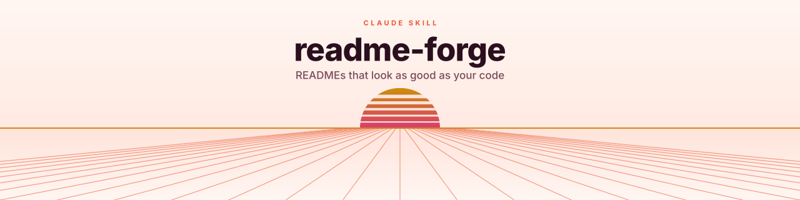</picture>

<b><code>--style synthwave</code></b><br><sub>3D perspective grid + striped sun</sub>

</td>
<td width="33%" valign="top">

<picture><source media="(prefers-color-scheme: dark)" srcset="readme-forge/assets/banners/isometric-dark.svg">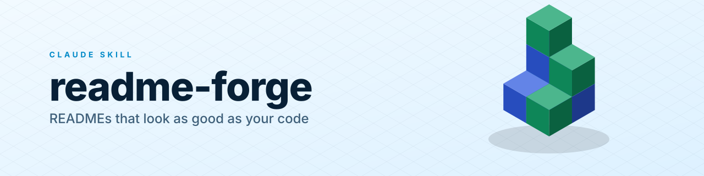</picture>

<b><code>--style isometric</code></b><br><sub>3D floating isometric cubes</sub>

</td>
</tr>
<tr>
<td width="33%" valign="top">

<picture><source media="(prefers-color-scheme: dark)" srcset="readme-forge/assets/banners/orbit-dark.svg"></picture>

<b><code>--style orbit</code></b><br><sub>3D tilted orbits, revolving planets</sub>

</td>
<td width="33%" valign="top">

<picture><source media="(prefers-color-scheme: dark)" srcset="readme-forge/assets/banners/glass-dark.svg"></picture>

<b><code>--style glass</code></b><br><sub>frosted glass over moving colour</sub>

</td>
<td width="33%" valign="top">

<picture><source media="(prefers-color-scheme: dark)" srcset="readme-forge/assets/banners/terminal-dark.svg"></picture>

<b><code>--style terminal</code></b><br><sub>code window that retypes the title</sub>

</td>
</tr>
<tr>
<td width="33%" valign="top">

<picture><source media="(prefers-color-scheme: dark)" srcset="readme-forge/assets/banners/neon-dark.svg">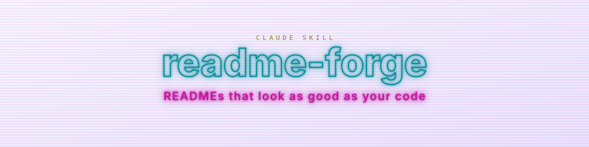</picture>

<b><code>--style neon</code></b><br><sub>glowing neon outline</sub>

</td>
<td width="33%" valign="top">

<picture><source media="(prefers-color-scheme: dark)" srcset="readme-forge/assets/banners/wave-dark.svg"></picture>

<b><code>--style wave</code></b><br><sub>layered animated waves</sub>

</td>
<td width="33%" valign="top">

<picture><source media="(prefers-color-scheme: dark)" srcset="readme-forge/assets/banners/blueprint-dark.svg"></picture>

<b><code>--style blueprint</code></b><br><sub>engineering drawing that redraws</sub>

</td>
</tr>
<tr>
<td width="33%" valign="top">

<picture><source media="(prefers-color-scheme: dark)" srcset="readme-forge/assets/banners/constellation-dark.svg"></picture>

<b><code>--style constellation</code></b><br><sub>twinkling particle network</sub>

</td>
<td width="33%" valign="top">

<picture><source media="(prefers-color-scheme: dark)" srcset="readme-forge/assets/banners/minimal-dark.svg"></picture>

<b><code>--style minimal</code></b><br><sub>clean type, one sweeping accent</sub>

</td>
<td width="33%" valign="top">

<picture><source media="(prefers-color-scheme: dark)" srcset="readme-forge/assets/banners/bold-dark.svg"></picture>

<b><code>--style bold</code></b><br><sub>oversized type, moving gradient</sub>

</td>
</tr>
</table>

```bash
python readme-forge/scripts/make_banner.py --style isometric --palette ocean --title "kubeforge" --subtitle "Clusters in one command" --out .github/assets
python readme-forge/scripts/make_banner.py --kind footer --style wave --title "Thanks for visiting" --out .github/assets
```

<details>
<summary><b>ShaderGradient presets, CTA buttons, footers and dividers</b></summary>
<br>

<picture><source media="(prefers-color-scheme: dark)" srcset="readme-forge/assets/banners/footer-wave-dark.svg"></picture>

<picture><source media="(prefers-color-scheme: dark)" srcset="readme-forge/assets/banners/footer-minimal-dark.svg"></picture>

<picture><source media="(prefers-color-scheme: dark)" srcset="readme-forge/assets/banners/divider-aurora-dark.svg"></picture>

**ShaderGradient presets** (`--style shader --palette …`):

<picture><source media="(prefers-color-scheme: dark)" srcset="readme-forge/assets/banners/presets/shader-halo-dark.svg"></picture>

<picture><source media="(prefers-color-scheme: dark)" srcset="readme-forge/assets/banners/presets/shader-pensive-dark.svg"></picture>

<picture><source media="(prefers-color-scheme: dark)" srcset="readme-forge/assets/banners/presets/shader-interstella-dark.svg"></picture>

<picture><source media="(prefers-color-scheme: dark)" srcset="readme-forge/assets/banners/presets/shader-universe-dark.svg"></picture>

<picture><source media="(prefers-color-scheme: dark)" srcset="readme-forge/assets/banners/presets/shader-mandarin-dark.svg"></picture>

<picture><source media="(prefers-color-scheme: dark)" srcset="readme-forge/assets/banners/presets/shader-nighty-dark.svg"></picture>

**CTA buttons** (`--kind button --variant primary|secondary`), clickable because each one is an image inside a link:

<picture><source media="(prefers-color-scheme: dark)" srcset="readme-forge/assets/banners/button-primary-dark.svg"></picture> <picture><source media="(prefers-color-scheme: dark)" srcset="readme-forge/assets/banners/button-secondary-dark.svg"></picture>

Palettes: `ember` · `ocean` · `violet` · `mint` · `sunset` · `mono` · `cyber` · dark-design `midnight` · `carbon` · `obsidian` · ShaderGradient `halo` · `pensive` · `interstella` · `universe` · `mandarin` · `nighty`, or pass any brand colour with `--accent "#HEX"`.

</details>

## What you can ask

| You say | You get |
|---|---|
| "Write a README for this repo" | Project README from code facts, a designed header and footer, and an architecture diagram |
| "Make my GitHub profile README, creative style" | A profile from 11 archetypes with a hero banner, working widgets and an optional 3D contribution calendar |
| "Review my README and fix it" | A score, drift report and ranked fixes, then a rewrite in your voice |
| "Give my README a better header" | 2–3 banner options in your brand colour, ready to paste |
| "Create a model card for this fine-tune" | A Hugging Face card with validated YAML |
| "Make this repo open-source ready" | README + CONTRIBUTING, SECURITY, Code of Conduct, issue/PR templates |
| "Make a PyPI version of my README" | A copy with absolute image links and no GitHub-only syntax, so it renders on PyPI and npm |

## Templates included

| Kind | Templates |
|---|---|
| **Profile READMEs** (11) | `minimal` · `creative` · `stats-dashboard` · `code-mode` · `badges-wall` · `retro` · `student` · `data-scientist` · `oss-maintainer` · `actions-dynamic` · `org-profile` |
| **Project READMEs** (7) | `api` · `cli` · `library` · `webapp` · `ml-project` · `monorepo` · `minimal` |
| **Hugging Face** (3) | model card · dataset card · Space README, each with validated YAML frontmatter |
| **Design blocks** (6) | centered header · profile header · landing-page hero · CTA section · SVG footer · quiet footer |
| **Companion docs** | CONTRIBUTING · CODE_OF_CONDUCT · SECURITY · SUPPORT · CHANGELOG · CITATION.cff · FUNDING · issue forms · PR template |
| **Profile Actions** (5) | contribution snake · latest blog posts · WakaTime stats · metrics · 3D contribution calendar |

Every widget URL in the profile templates was checked with `check_links.py`. Services that now fail, such as the public trophy and activity-graph hosts that return HTTP 402, are left out or replaced by self-hosted Actions.

## How it works

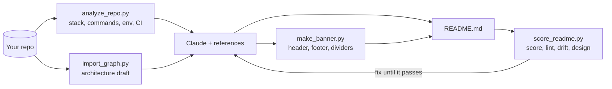

Every script runs on its own with Python 3.8+ and no dependencies. See the [skill docs](readme-forge/README.md).

## Scripts

| Script | What it does | Example |
|---|---|---|
| `analyze_repo.py` | Prints the repo's facts as JSON: languages, package manager, scripts, env vars, Docker, CI, license, Hugging Face files | `python readme-forge/scripts/analyze_repo.py . --compact` |
| `import_graph.py` | Draws a Mermaid architecture draft from real imports (Python, JS/TS, Go, Rust) | `python readme-forge/scripts/import_graph.py . --mermaid` |
| `score_readme.py` | Scores a README 0–100, lints it and checks it against the code | `python readme-forge/scripts/score_readme.py README.md --repo . --min 85` |
| `check_links.py` | Finds dead links, broken badges and widgets that return error cards | `python readme-forge/scripts/check_links.py README.md` |
| `make_banner.py` | Generates animated SVG headers, footers, dividers and buttons | `python readme-forge/scripts/make_banner.py --list` |

Use `score_readme.py --min 85` in CI to stop a README from getting worse. This repo's own [CI](.github/workflows/ci.yml) does exactly that.

## FAQ

<details>
<summary><b>Does it send my code anywhere?</b></summary>

The scripts only read files on your machine. Only `check_links.py` uses the network, and only for the URLs already in your README. What Claude sees is governed by your normal Claude Code settings.
</details>

<details>
<summary><b>What if it can't find something, like the install command?</b></summary>

It leaves a `TODO` in the README and lists every TODO back to you. It never makes up commands, versions or benchmark numbers.
</details>

<details>
<summary><b>Will the animated banners work on PyPI, npm or Hugging Face?</b></summary>

GitHub renders them, including dark and light variants. Other platforms ignore `<picture>`, so ask for "a PyPI version" and the skill switches to absolute URLs and single images.
</details>

<details>
<summary><b>Which languages get architecture diagrams?</b></summary>

Python, JavaScript/TypeScript, Go and Rust. For other languages the skill still writes the README and sketches the diagram from the folder layout, marked as a draft.
</details>

## Roadmap

- [x] Project, profile and Hugging Face READMEs grounded in code
- [x] 0–100 scorer with drift detection
- [x] 15 animated banner styles with dark/light variants
- [x] Claude Code plugin install
- [ ] GitHub Action that comments the README score on pull requests
- [ ] Architecture diagrams for Java, C# and PHP
- [ ] Check that documented CLI flags and API routes exist in the code
- [ ] More banner styles from the community ([suggest one](https://github.com/tanmayai23/README-Editor-skill/issues/new?template=feature_request.yml))

<div align="center">

### Start writing READMEs people actually read

One command reads your code, designs the page and checks it.

<a href="#quickstart"><picture><source media="(prefers-color-scheme: dark)" srcset=".github/assets/cta-primary-dark.svg"></picture></a>

<sub>Free and open source · 2-minute setup</sub>

</div>

## Contributing

Issues and pull requests are welcome. Read [CONTRIBUTING.md](CONTRIBUTING.md) first. Good places to start:

- **Report a broken widget** with the [widget form](https://github.com/tanmayai23/README-Editor-skill/issues/new?template=broken_widget.yml). Widget hosts change often, and this keeps the profile templates working.
- **Add a banner style.** Include both the dark and light renders and keep the first frame complete.
- **Share a README you made** in [Discussions](https://github.com/tanmayai23/README-Editor-skill/discussions).

Please follow the [Code of Conduct](CODE_OF_CONDUCT.md). Report security issues privately as described in [SECURITY.md](SECURITY.md).

<a href="https://github.com/tanmayai23/README-Editor-skill/graphs/contributors"></a>

### Star history

<a href="https://star-history.com/#tanmayai23/README-Editor-skill&Date">
  <picture>
    <source media="(prefers-color-scheme: dark)" srcset="https://api.star-history.com/svg?repos=tanmayai23/README-Editor-skill&type=Date&theme=dark">
    
  </picture>
</a>

## Acknowledgements

Built after studying [readme-md-generator](https://github.com/kefranabg/readme-md-generator), [The Documentation Compendium](https://github.com/race2infinity/The-Documentation-Compendium), [awesome-github-profile-readme](https://github.com/abhisheknaiidu/awesome-github-profile-readme), [awesome-github-profile-readme-templates](https://github.com/durgeshsamariya/awesome-github-profile-readme-templates) and [Best-README-Template](https://github.com/othneildrew/Best-README-Template). Widgets by [shields.io](https://shields.io), [github-readme-stats](https://github.com/anuraghazra/github-readme-stats), [readme-typing-svg](https://github.com/DenverCoder1/readme-typing-svg) and [skill-icons](https://github.com/tandpfun/skill-icons).

## License

Distributed under the MIT License. See [LICENSE](LICENSE).

---

<picture>
  <source media="(prefers-color-scheme: dark)" srcset=".github/assets/footer-dark.svg">
  
</picture>

<p align="right"><a href="#top">Back to top ↑</a></p>
