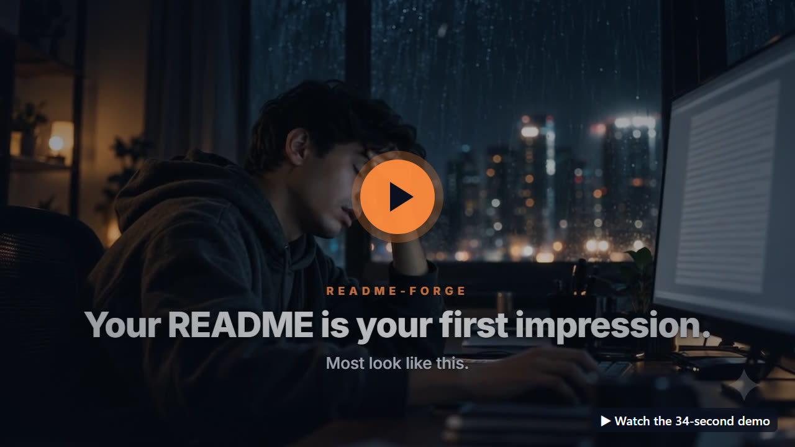
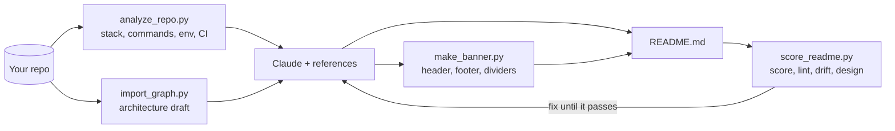

<a id="top"></a>
<a href="#readme-forge">
  <picture>
    <source media="(prefers-color-scheme: dark)" srcset=".github/assets/header-dark.svg">
    
  </picture>
</a>

<p align="center"><b>A Claude skill that writes, designs, scores and fixes READMEs using facts from your actual code.</b></p>

<p align="center">
  
  
  
  <a href="LICENSE"></a>
</p>

<p align="center">
  <a href="#quickstart">Quickstart</a> •
  <a href="#banner-gallery">Banner gallery</a> •
  <a href="#what-you-can-ask">What you can ask</a> •
  <a href="#how-it-works">How it works</a> •
  <a href="readme-forge/README.md">Skill docs</a>
</p>

<br>

<!-- To get an inline video player: edit this README on github.com, drag demo/readme-forge-cinematic.mp4 into the editor,
     and replace the poster block below with the https://github.com/user-attachments/assets/… link GitHub inserts. -->
<p align="center">
  <a href="demo/readme-forge-cinematic.mp4"></a>
</p>

## Why

Most README generators fill one template. Most profile galleries ask you to copy someone else's file. Neither reads your code, and neither designs anything. readme-forge does both:

| | Other tools | readme-forge |
|---|---|---|
| **Facts** | Typed in by hand, or read from `package.json` only | Detects 15+ ecosystems, scripts, env vars, Docker, CI, routes; never invents commands |
| **Visuals** | A logo if you have one | Mermaid architecture **from real imports**, plus 12 animated banner styles with dark/light variants |
| **Widgets** | Hard-coded public URLs (some now return HTTP 402) | Tested endpoints, self-hosted SVGs that can't rate-limit, reliability tiers |
| **Quality** | None | A 0–100 score and linter: structure, accessibility, dead links, drift, design |
| **Platforms** | GitHub only | GitHub, Hugging Face cards, PyPI, npm, GitLab |

## Quickstart

<!-- TODO: replace OWNER with your GitHub username after publishing -->
```bash
git clone https://github.com/OWNER/readme-forge
cp -r readme-forge/readme-forge ~/.claude/skills/readme-forge
```

Then, in any project, open Claude Code and run:

```text
/readme-forge write a README for this repo, with a header and footer
```

On claude.ai or Claude Desktop, upload `readme-forge.zip` under **Settings → Capabilities → Skills**.

## Banner gallery

Every banner is a **self-contained animated SVG** that you commit to your repo, so there are no external services, rate limits or broken images. Each comes in a dark and a light variant (switch your GitHub theme to see both), shows a complete first frame, and stops moving for visitors who turn on reduce motion.

<table>
<tr>
<td width="50%" valign="top">

<picture><source media="(prefers-color-scheme: dark)" srcset="readme-forge/assets/banners/aurora-dark.svg"></picture>

<b><code>--style aurora</code></b><br><sub>drifting mesh-gradient light</sub>

</td>
<td width="50%" valign="top">

<picture><source media="(prefers-color-scheme: dark)" srcset="readme-forge/assets/banners/synthwave-dark.svg"></picture>

<b><code>--style synthwave</code></b><br><sub>3D perspective grid + striped sun</sub>

</td>
</tr>
<tr>
<td width="50%" valign="top">

<picture><source media="(prefers-color-scheme: dark)" srcset="readme-forge/assets/banners/isometric-dark.svg"></picture>

<b><code>--style isometric</code></b><br><sub>3D floating isometric cubes</sub>

</td>
<td width="50%" valign="top">

<picture><source media="(prefers-color-scheme: dark)" srcset="readme-forge/assets/banners/orbit-dark.svg"></picture>

<b><code>--style orbit</code></b><br><sub>3D tilted orbits, revolving planets</sub>

</td>
</tr>
<tr>
<td width="50%" valign="top">

<picture><source media="(prefers-color-scheme: dark)" srcset="readme-forge/assets/banners/glass-dark.svg"></picture>

<b><code>--style glass</code></b><br><sub>frosted glass over moving colour</sub>

</td>
<td width="50%" valign="top">

<picture><source media="(prefers-color-scheme: dark)" srcset="readme-forge/assets/banners/terminal-dark.svg"></picture>

<b><code>--style terminal</code></b><br><sub>code window that retypes the title</sub>

</td>
</tr>
<tr>
<td width="50%" valign="top">

<picture><source media="(prefers-color-scheme: dark)" srcset="readme-forge/assets/banners/neon-dark.svg"></picture>

<b><code>--style neon</code></b><br><sub>glowing neon outline</sub>

</td>
<td width="50%" valign="top">

<picture><source media="(prefers-color-scheme: dark)" srcset="readme-forge/assets/banners/wave-dark.svg"></picture>

<b><code>--style wave</code></b><br><sub>layered animated waves</sub>

</td>
</tr>
<tr>
<td width="50%" valign="top">

<picture><source media="(prefers-color-scheme: dark)" srcset="readme-forge/assets/banners/blueprint-dark.svg"></picture>

<b><code>--style blueprint</code></b><br><sub>engineering drawing that redraws</sub>

</td>
<td width="50%" valign="top">

<picture><source media="(prefers-color-scheme: dark)" srcset="readme-forge/assets/banners/constellation-dark.svg"></picture>

<b><code>--style constellation</code></b><br><sub>twinkling particle network</sub>

</td>
</tr>
<tr>
<td width="50%" valign="top">

<picture><source media="(prefers-color-scheme: dark)" srcset="readme-forge/assets/banners/minimal-dark.svg"></picture>

<b><code>--style minimal</code></b><br><sub>clean type, one sweeping accent</sub>

</td>
<td width="50%" valign="top">

<picture><source media="(prefers-color-scheme: dark)" srcset="readme-forge/assets/banners/bold-dark.svg"></picture>

<b><code>--style bold</code></b><br><sub>oversized type, moving gradient</sub>

</td>
</tr>
</table>

```bash
python readme-forge/scripts/make_banner.py --style isometric --palette ocean --title "kubeforge" --subtitle "Clusters in one command" --out .github/assets
python readme-forge/scripts/make_banner.py --kind footer --style wave --title "Thanks for visiting" --out .github/assets
```

<details>
<summary><b>Footers and dividers</b></summary>
<br>

<picture><source media="(prefers-color-scheme: dark)" srcset="readme-forge/assets/banners/footer-wave-dark.svg"></picture>

<picture><source media="(prefers-color-scheme: dark)" srcset="readme-forge/assets/banners/footer-minimal-dark.svg"></picture>

<picture><source media="(prefers-color-scheme: dark)" srcset="readme-forge/assets/banners/divider-aurora-dark.svg"></picture>

Palettes: `ember` · `ocean` · `violet` · `mint` · `sunset` · `mono` · `cyber`, or pass any brand colour with `--accent "#HEX"`.

</details>

## What you can ask

| You say | You get |
|---|---|
| "Write a README for this repo" | Project README from code facts, a designed header and footer, and an architecture diagram |
| "Make my GitHub profile README, creative style" | A profile from 11 archetypes with a hero banner, working widgets and an optional 3D contribution calendar |
| "Review my README and fix it" | A score, drift report and ranked fixes, then a rewrite in your voice |
| "Give my README a better header" | 2–3 banner options in your brand colour, ready to paste |
| "Create a model card for this fine-tune" | A Hugging Face card with validated YAML |
| "Make this repo open-source ready" | README + CONTRIBUTING, SECURITY, Code of Conduct, issue/PR templates |

## How it works



Every script runs on its own with Python 3.8+ and no dependencies. See the [skill docs](readme-forge/README.md).

## Contributing

Issues and pull requests are welcome. If you add a banner style, include both the dark and light renders and keep the first frame complete.

## License

Distributed under the MIT License. See [LICENSE](LICENSE).

---

<picture>
  <source media="(prefers-color-scheme: dark)" srcset=".github/assets/footer-dark.svg">
  
</picture>

<p align="right"><a href="#top">Back to top ↑</a></p>
