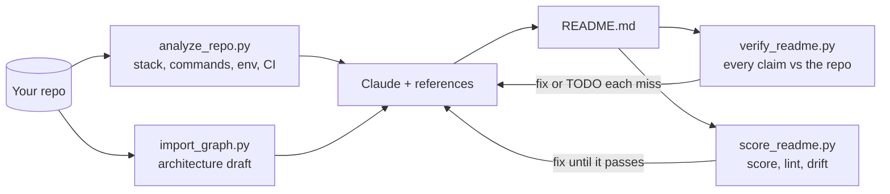
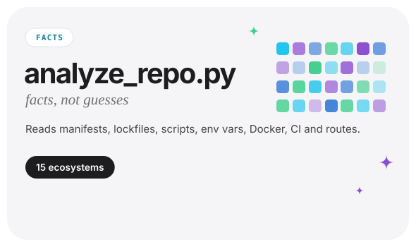
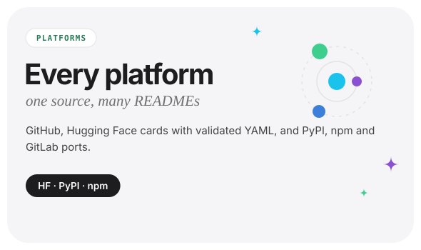

<a id="top"></a>

<a href="#why"><picture><source media="(prefers-color-scheme: dark)" srcset=".github/assets/page/hero-dark.svg"></picture></a>

<p align="center"><b>A Claude skill that writes READMEs from your code, then checks every command, env var and path in them against the repo.</b></p>

<p align="center">
  <a href="https://github.com/tanmayai23/README-Editor-skill/actions/workflows/ci.yml"></a>
  <a href="https://github.com/tanmayai23/README-Editor-skill/releases"></a>
  <a href="LICENSE"></a>
  
</p>

<p align="center">
  <a href="#quickstart"><picture><source media="(prefers-color-scheme: dark)" srcset=".github/assets/cta-primary-dark.svg"></picture></a>
  &nbsp;
  <a href="readme-forge-design/assets/banners/gallery.md"><picture><source media="(prefers-color-scheme: dark)" srcset=".github/assets/cta-secondary-dark.svg"></picture></a>
</p>

<p align="center"><a href="#why">Why</a> · <a href="#quickstart">Quickstart</a> · <a href="#how-it-works">How it works</a> · <a href="#scripts">Scripts</a> · <a href="#check-readmes-in-ci">CI</a> · <a href="#how-far-to-trust-the-score">Trust</a> · <a href="#optional-design-and-profiles">Design</a> · <a href="#faq">FAQ</a> · <a href="#roadmap">Roadmap</a></p>

<p align="center">
<a href="#quickstart"><picture><source media="(prefers-color-scheme: dark)" srcset=".github/assets/page/more-in-claude-dark.svg"></picture></a>
<a href="#check-readmes-in-ci"><picture><source media="(prefers-color-scheme: dark)" srcset=".github/assets/page/more-in-ci-dark.svg"></picture></a>
<a href="#try-it-without-claude"><picture><source media="(prefers-color-scheme: dark)" srcset=".github/assets/page/more-on-its-own-dark.svg"></picture></a>
</p>

## Why

A README generator that guesses is worse than none: a wrong install command costs a new user more than a missing one. readme-forge reads the repo first, writes only what it can point to in a file, and leaves a `TODO` where it can't. Then `verify_readme.py` checks the result claim by claim.

This is its real output on a test fixture: a pnpm app whose README was seeded with five mistakes.

```text
$ python readme-forge/scripts/verify_readme.py README.bad.md --repo tests/fixtures/verify/node-app
✓    6  command         npm install  [package.json exists]
✗    6  package_manager npm  [repo uses pnpm (pnpm-lock.yaml), not npm]
✗    7  script          pnpm run deploy  [no 'deploy' script in package.json (scripts: dev, test)]
✓    7  package_manager pnpm  [pnpm-lock.yaml matches pnpm]
✗    8  env_var         REDIS_URL  [not referenced in any code, config or .env file]
✗    9  command         docker compose up worker  [no service worker in docker-compose.yml (services: api, db)]
✗   12  path            docs/setup.md  [no docs/setup.md in the repo]
claims: 7 checked · 2 verified · 5 not found · 0 unverifiable · 1 generic · accuracy 28.6%
```

> [!IMPORTANT]
> Every `✗` is something the README says that the code doesn't have. The skill doesn't finish until there are none.

## Quickstart

Install the skill once from any terminal. It then works in every project:

```bash
claude plugin install readme-forge --marketplace tanmayai23/README-Editor-skill
```

Then, in Claude Code:

```text
/readme-forge write a README for this repo
```

You can also just say "improve my README" or "is my README accurate?". From a script: `claude -p "/readme-forge audit README.md and fix every error"`.

**claude.ai or Claude Desktop:** download `readme-forge.zip` from the [latest release](https://github.com/tanmayai23/README-Editor-skill/releases/latest) and upload it under **Settings → Capabilities → Skills**.

<details>
<summary>Older Claude Code, project-only install, updating, or manual install</summary>

Older versions add the marketplace first:

```bash
claude plugin marketplace add tanmayai23/README-Editor-skill
claude plugin install readme-forge@readme-forge
```

Add `--scope project` to install for one project and share it with your team. Update with `claude plugin marketplace update readme-forge`, then `claude plugin update readme-forge@readme-forge`. To install by hand, copy the `readme-forge` folder to `~/.claude/skills/readme-forge`.

</details>

### Try it without Claude

The scripts run on their own as a free README linter and fact checker. Run them on the sample app in this repo:

```bash
git clone https://github.com/tanmayai23/README-Editor-skill.git
cd README-Editor-skill
python readme-forge/scripts/verify_readme.py demo/sample-app/README.after.md --repo demo/sample-app   # 12 of 12 claims match
python readme-forge/scripts/score_readme.py demo/sample-app/README.before.md --repo demo/sample-app   # 43/100, grade F
python readme-forge/scripts/score_readme.py demo/sample-app/README.after.md --repo demo/sample-app    # 95/100, grade A
```

<details>
<summary><b>Watch the demo</b> (a 43/100 README rewritten by one command)</summary>
<br>

<p align="center">
  
</p>

<a href="demo/readme-forge-cinematic.mp4">Full 34-second demo in HD</a>. The scorer is this repo's own, so treat the score as a checklist, not proof; the claim check is the part you can audit line by line.

</details>

## How it works



<p align="center">
<picture><source media="(prefers-color-scheme: dark)" srcset=".github/assets/page/project-verify-readme-py-dark.svg"></picture>
<picture><source media="(prefers-color-scheme: dark)" srcset=".github/assets/page/project-analyze-repo-py-dark.svg"></picture>
<picture><source media="(prefers-color-scheme: dark)" srcset=".github/assets/page/project-import-graph-py-dark.svg"></picture>
<picture><source media="(prefers-color-scheme: dark)" srcset=".github/assets/page/project-score-readme-py-dark.svg"></picture>
<picture><source media="(prefers-color-scheme: dark)" srcset=".github/assets/page/project-every-platform-dark.svg"></picture>
</p>

`analyze_repo.py` covers Node, Python, Rust, Go, JVM, Ruby, PHP, Dart, Elixir, .NET, C/C++, Deno, Swift, Zig and Haskell, each with a fixture and a unit test. The skill also writes companion docs: CONTRIBUTING, SECURITY, Code of Conduct, CITATION.cff, and issue and PR templates.

## Scripts

| Script | What it does | Example |
|---|---|---|
| `analyze_repo.py` | Prints the repo's facts as JSON | `python readme-forge/scripts/analyze_repo.py . --compact` |
| `verify_readme.py` | Checks every claim in a README against the repo | `python readme-forge/scripts/verify_readme.py README.md --repo .` |
| `score_readme.py` | Scores a README 0–100, lints it and checks drift | `python readme-forge/scripts/score_readme.py README.md --repo . --min 85` |
| `import_graph.py` | Draws a Mermaid architecture draft from real imports | `python readme-forge/scripts/import_graph.py . --mermaid` |
| `check_links.py` | Finds dead links, broken badges and widgets that return error cards | `python readme-forge/scripts/check_links.py README.md` |

> [!TIP]
> This README passes its own checks: [CI](.github/workflows/ci.yml) runs `verify_readme.py --min-accuracy 100` and `score_readme.py --min 85` on it, plus the unit tests in `tests/`.

## Check READMEs in CI

The repo is also a GitHub Action. It scores and fact-checks the README on every pull request and keeps one comment up to date:

```yaml
name: README check
on: pull_request
permissions: { contents: read, pull-requests: write }
jobs:
  readme:
    runs-on: ubuntu-latest
    steps:
      - uses: actions/checkout@v4
      - uses: tanmayai23/README-Editor-skill@v1
        with: { min-score: 80, min-accuracy: 100 }
```

| Input | Default | What it does |
|---|---|---|
| `path` | `README.md` | README file(s) to check, separated by spaces or newlines |
| `repo-root` | `.` | Repository root the README describes |
| `min-score` | `0` | Fail below this score (0 never fails) |
| `min-accuracy` | `0` | Fail when fewer than this percent of claims match the code |
| `comment` | `true` | Post and keep updating one report comment on the PR |

Outputs (`score`, `grade`, `accuracy`, `report`) and a sample comment are in [action/README.md](action/README.md).

## How far to trust the score

The claim check is the part you can audit line by line. The 0–100 score is a rubric, so it was tested: on 25 READMEs from [awesome-readme](https://github.com/matiassingers/awesome-readme) against 25 neglected ones, pinned to commit SHAs. The well-regarded READMEs averaged 67.5 against 37.0, 21 of 25 scored 55 or more against 4 of 25, and the AUC (the chance a good one outscores a neglected one) was **0.914**.

<a href="bench/scorer-validation/README.md"><picture><source media="(prefers-color-scheme: dark)" srcset=".github/assets/page/project-the-score-tested-dark.svg"></picture></a>

The same report lists where the rubric falls short. It rewards having the expected headings more than their content (a filled-in bootcamp template scored highest of all 50), and README length alone separated the groups better (AUC 0.979). Read the method, failure cases and how to reproduce it in [bench/scorer-validation](bench/scorer-validation/README.md). Use the score as a checklist, not a verdict.

## Optional: design and profiles

Whole-page design, banners, CTA buttons and GitHub profile READMEs live in a separate plugin, so the core skill stays about accuracy:

```bash
claude plugin install readme-forge-design --marketplace tanmayai23/README-Editor-skill
```

Its page kit designs the whole README, not just the ends. You write one JSON spec, and `make_page.py` turns it into a set of matching cards in light and dark: a terminal-window hero, a contact dock, numbered section headers, an about card, a tech-stack grid with real brand icons, project and achievement cards, themed stats and a footer. [This profile](readme-forge-design/examples/keynote-profile/README.md) is built entirely from one spec.

<a href="readme-forge-design/examples/keynote-profile/README.md"><picture><source media="(prefers-color-scheme: dark)" srcset="readme-forge-design/examples/keynote-profile/assets/hello/project-tidewatch-dark.svg"></picture></a>

It also generates self-contained animated SVG headers in 20 styles. The newest four rebuild the look of WebGL shader scenes in plain SVG and CSS, so GitHub can render them: a spinning vortex, a light beam racing around the edge, voronoi glass and RGB-split blinds. The cards on this page come from the page kit ([spec](.github/page.json)), and the buttons under the hero are `--kind button`.

<table>
<tr>
<td width="50%"><picture><source media="(prefers-color-scheme: dark)" srcset="readme-forge-design/assets/banners/beam-dark.svg"></picture></td>
<td width="50%"><picture><source media="(prefers-color-scheme: dark)" srcset="readme-forge-design/assets/banners/prism-dark.svg"></picture></td>
</tr>
</table>

It also has 19 profile README archetypes with tested widgets and 6 profile Actions. See the [design README](readme-forge-design/README.md) or the [banner gallery](readme-forge-design/assets/banners/gallery.md) for every style.

## Troubleshooting

<details>
<summary>Install and run problems</summary>

| Problem | Fix |
|---|---|
| `/plugin isn't available in this environment` | Run `claude plugin install readme-forge --marketplace tanmayai23/README-Editor-skill` in a normal terminal, then open a new chat |
| `Unknown command: /readme-forge` after installing | Start a new Claude Code session. Plugins load at startup |
| Two `readme-forge` skills, or the wrong one runs | You have the plugin and a manual copy. Use `/readme-forge:readme-forge`, or delete `~/.claude/skills/readme-forge` |
| `python: command not found` | Install Python 3.8+. On macOS and Linux, tell Claude to use `python3` |
| Garbled `█` bars in Windows PowerShell | Run `[Console]::OutputEncoding = [Text.Encoding]::UTF8` once, or use Windows Terminal |

</details>

Something else? [Open an issue](https://github.com/tanmayai23/README-Editor-skill/issues/new?template=bug_report.yml) with your OS, Claude Code version (`claude --version`) and the error.

## FAQ

<details>
<summary><b>Does it send my code anywhere?</b></summary>

The scripts only read files on your machine. Only `check_links.py` uses the network, and only for the URLs already in your README. What Claude sees is governed by your normal Claude Code settings.
</details>

<details>
<summary><b>What can't the claim check verify?</b></summary>

It works offline, so it can't tell whether `pip install NAME` resolves on PyPI or whether a command succeeds at runtime. Those claims are reported as unverifiable, never as correct. Commands written in plain prose, outside code, aren't extracted.
</details>

<details>
<summary><b>What if it can't find something, like the install command?</b></summary>

It leaves a `TODO` in the README and lists every TODO back to you.
</details>

<details>
<summary><b>Can it design the whole README, not just a banner?</b></summary>

Yes, with the optional design plugin. Its page kit turns one JSON spec into a full set of matching light and dark cards: hero, contact dock, section headers, about, tech stack, projects, achievements, stats and footer. Install steps and code stay as real Markdown, so they remain copyable and checkable. See the [fictional demo profile](readme-forge-design/examples/keynote-profile/README.md). If you share your own README as a style sample, the skill copies its layout, not your personal details.
</details>

## Roadmap

- [x] Project and Hugging Face READMEs grounded in code, with tests for 15 ecosystems
- [x] Claim-by-claim verification of commands, flags, env vars and paths
- [x] GitHub Action that comments the score and claim check on pull requests ([#1](https://github.com/tanmayai23/README-Editor-skill/issues/1))
- [x] Scorer validated against 50 pinned READMEs, with its weak spots written down ([bench/scorer-validation](bench/scorer-validation/README.md))
- [x] Page kit: the whole README designed as light and dark SVG cards from one spec ([readme-forge-design](readme-forge-design/README.md#page-kit))
- [ ] Published benchmark against Claude without the skill on 20 pinned third-party repos ([#12](https://github.com/tanmayai23/README-Editor-skill/issues/12))
- [ ] Architecture diagrams for Java/Kotlin ([#3](https://github.com/tanmayai23/README-Editor-skill/issues/3)), C# ([#4](https://github.com/tanmayai23/README-Editor-skill/issues/4)), PHP and Ruby ([#5](https://github.com/tanmayai23/README-Editor-skill/issues/5))
- [ ] Check documented API routes against the code ([#6](https://github.com/tanmayai23/README-Editor-skill/issues/6))
- [ ] Mermaid pre-rendering for PyPI, npm and Hugging Face ([#7](https://github.com/tanmayai23/README-Editor-skill/issues/7))

See all [open issues](https://github.com/tanmayai23/README-Editor-skill/issues), or start with a [`good first issue`](https://github.com/tanmayai23/README-Editor-skill/issues?q=is%3Aopen+label%3A%22good+first+issue%22).

## Contributing

Issues and pull requests are welcome. Read [CONTRIBUTING.md](CONTRIBUTING.md) first; `python -m unittest discover -s tests` runs the same tests as CI. Using readme-forge or the Action in your own repo? [Tell us in Discussions](https://github.com/tanmayai23/README-Editor-skill/discussions); real-world reports are the most useful feedback we get.

Please follow the [Code of Conduct](CODE_OF_CONDUCT.md). Report security issues privately as described in [SECURITY.md](SECURITY.md).

### Contributors

Code, design, docs, ideas and bug reports all count ([emoji key](https://allcontributors.org/emoji-key/)).

<!-- ALL-CONTRIBUTORS-LIST:START - Do not remove or modify this section -->
<!-- prettier-ignore-start -->
<!-- markdownlint-disable -->
<table>
  <tbody>
    <tr>
      <td align="center" valign="top" width="14.28%"><a href="https://github.com/tanmayai23"><br /><sub><b>Tanmay kala</b></sub></a><br /><a href="https://github.com/tanmayai23/README-Editor-skill/commits?author=tanmayai23" title="Code">💻</a> <a href="https://github.com/tanmayai23/README-Editor-skill/tree/main/readme-forge-design/assets" title="Design">🎨</a> <a href="https://github.com/tanmayai23/README-Editor-skill/commits?author=tanmayai23" title="Documentation">📖</a> <a href="https://github.com/tanmayai23/README-Editor-skill/tree/main/.github/workflows" title="Infrastructure (Hosting, Build-Tools, etc)">🚇</a> <a href="https://github.com/tanmayai23/README-Editor-skill/pulls?q=is%3Apr+reviewed-by%3Atanmayai23" title="Maintenance">🚧</a></td>
      <td align="center" valign="top" width="14.28%"><a href="https://github.com/Sultanast01"><br /><sub><b>Sultanast01</b></sub></a><br /><a href="https://github.com/tanmayai23/README-Editor-skill/pull/17" title="Code">💻</a> <a href="https://github.com/tanmayai23/README-Editor-skill/pull/15" title="Design">🎨</a></td>
    </tr>
  </tbody>
</table>

<!-- markdownlint-restore -->
<!-- prettier-ignore-end -->

<!-- ALL-CONTRIBUTORS-LIST:END -->

## License

Distributed under the MIT License. See [LICENSE](LICENSE).

<a href="#top"><picture><source media="(prefers-color-scheme: dark)" srcset=".github/assets/page/footer-dark.svg"></picture></a>

<p align="right"><a href="#top">Back to top ↑</a></p>
