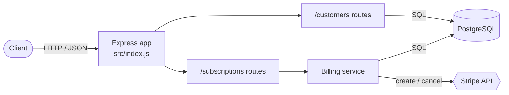

# orbit-api

**A subscription billing API for small SaaS teams: manage customers in PostgreSQL and subscriptions in Stripe through five REST endpoints.**


**Contents:** [Features](#features) · [Quickstart](#quickstart) · [Endpoints](#endpoints) · [Configuration](#configuration) · [Architecture](#architecture) · [Development](#development)

## Features

- **Customers**: create and list customers stored in PostgreSQL
- **Subscriptions**: start and cancel Stripe subscriptions; the customer's plan is updated in the same request
- **Health check**: `GET /health` for load balancers and uptime monitors

## Quickstart

> [!IMPORTANT]
> Requires Node.js 20+, pnpm, a PostgreSQL database and a Stripe test key.

```bash
git clone <repo-url> orbit-api
cd orbit-api
pnpm install
cp .env.example .env    # then fill in DATABASE_URL and STRIPE_SECRET_KEY
pnpm dev
```

```bash
curl http://localhost:3000/health
# {"ok":true}
```

## Endpoints

| Method | Path | Description |
|---|---|---|
| `GET` | `/health` | Liveness check |
| `GET` | `/customers` | List customers (id, email, plan) |
| `POST` | `/customers` | Create a customer: `{"email": "a@b.co"}` |
| `POST` | `/subscriptions` | Subscribe a customer: `{"customerId": 1, "priceId": "price_…"}` |
| `DELETE` | `/subscriptions/:id` | Cancel a Stripe subscription |

## Configuration

| Variable | Required | Default | Description |
|---|---|---|---|
| `DATABASE_URL` | ✅ | — | PostgreSQL connection string |
| `STRIPE_SECRET_KEY` | ✅ | — | Stripe secret key (use `sk_test_…` locally) |
| `PORT` | | `3000` | HTTP port |

## Architecture

Express routes call PostgreSQL directly for customers, and go through a billing service that talks to Stripe for subscriptions.



## Development

| Task | Command |
|---|---|
| Run with auto-reload | `pnpm dev` |
| Run in production mode | `pnpm start` |
| Run tests | `pnpm test` |
| Lint | `pnpm lint` |

```text
src/
├── index.js               # Express app and route mounting
├── db.js                  # PostgreSQL pool (DATABASE_URL)
├── routes/
│   ├── customers.js
│   └── subscriptions.js
└── services/
    └── billing.js         # Stripe calls
```

## Contributing

Open an issue to discuss a change, then send a pull request. CI runs `pnpm test` on every push.

## License

Distributed under the MIT License. See [LICENSE](LICENSE).
