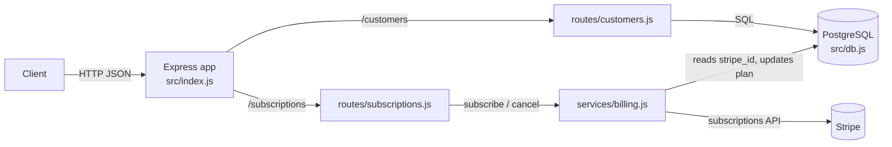

# orbit-api

Subscription billing API for small SaaS teams: an Express service that stores customers in PostgreSQL and creates and cancels their subscriptions through Stripe.


[](LICENSE)
<!-- TODO: add the CI badge once the GitHub remote is known:
[](https://github.com/OWNER/REPO/actions/workflows/ci.yml) -->

**Contents:** [Quickstart](#quickstart) · [Features](#features) · [Prerequisites](#prerequisites) · [Installation](#installation) · [Configuration](#configuration) · [API](#api) · [Architecture](#architecture) · [Development](#development) · [Contributing](#contributing) · [Contact](#contact) · [License](#license)

## Quickstart

```bash
pnpm install
cp .env.example .env   # then set DATABASE_URL and STRIPE_SECRET_KEY
pnpm dev
curl http://localhost:3000/health
# {"ok":true}
```

## Features

- **Customers**: list and create customers stored in PostgreSQL (`/customers`).
- **Subscriptions**: subscribe a customer to a Stripe price, or cancel a subscription (`/subscriptions`).
- **Plan tracking**: the customer's `plan` column is set to the Stripe price ID when they subscribe.
- **Health check**: `GET /health` for load balancers and uptime monitors.

## Prerequisites

- Node.js 20 or newer
- [pnpm](https://pnpm.io/installation)
- A PostgreSQL database
- A Stripe account and secret key (use a `sk_test_...` key during development)

## Installation

```bash
pnpm install
cp .env.example .env
```

Fill in `.env` (see [Configuration](#configuration)), then start the server:

```bash
pnpm start   # production
pnpm dev     # restarts on file changes (node --watch)
```

The server logs `orbit-api listening on :3000`.

### Database

The service reads and writes a `customers` table with `id`, `email`, `plan` and `stripe_id` columns.

<!-- TODO: the repo has no schema or migration file. Add one (or the CREATE TABLE statement) here. -->

## Configuration

Environment variables (see [`.env.example`](.env.example)):

| Variable | Required | Default | Description |
|---|---|---|---|
| `DATABASE_URL` | yes | none | PostgreSQL connection string, e.g. `postgres://localhost:5432/orbit` |
| `STRIPE_SECRET_KEY` | yes | none | Stripe secret API key, e.g. `sk_test_...` |
| `PORT` | no | `3000` | HTTP port the server listens on |

## API

| Method | Path | Body | Response |
|---|---|---|---|
| `GET` | `/health` | none | `200` `{"ok": true}` |
| `GET` | `/customers` | none | `200` array of `{id, email, plan}`, ordered by `id` |
| `POST` | `/customers` | `{"email": "..."}` | `201` the created customer row |
| `POST` | `/subscriptions` | `{"customerId": 1, "priceId": "price_..."}` | `201` the Stripe subscription object |
| `DELETE` | `/subscriptions/:id` | none | `204`; `:id` is the Stripe subscription ID |

Example:

```bash
curl -X POST http://localhost:3000/customers \
  -H "Content-Type: application/json" \
  -d '{"email": "ada@example.com"}'

curl -X POST http://localhost:3000/subscriptions \
  -H "Content-Type: application/json" \
  -d '{"customerId": 1, "priceId": "price_123"}'
```

> [!NOTE]
> `POST /subscriptions` uses the customer's `stripe_id`, but `POST /customers` does not create a Stripe customer or set that column. Set `stripe_id` for the customer before subscribing them.
<!-- TODO: document how stripe_id gets populated in your setup. -->

## Architecture



```text
src/
├── index.js               # Express app, /health, route mounting
├── db.js                  # pg connection pool (DATABASE_URL)
├── routes/
│   ├── customers.js       # GET/POST /customers
│   └── subscriptions.js   # POST /subscriptions, DELETE /subscriptions/:id
└── services/
    └── billing.js         # Stripe subscribe/cancel + plan update
test/
└── health.test.js
```

## Development

```bash
pnpm dev     # run with auto-reload
pnpm test    # node --test test/
pnpm lint    # eslint src
```

CI ([`.github/workflows/ci.yml`](.github/workflows/ci.yml)) runs `pnpm install && pnpm test` on every push and pull request.

## Contributing

Issues and pull requests are welcome. Run `pnpm lint` and `pnpm test` before you open a PR.

## Contact

<!-- TODO: add a contact email or link (the original README said "email me" without an address). -->

## License

[MIT](LICENSE)
