# readme-forge-design

**Animated SVG banners, CTA buttons and GitHub profile READMEs for [readme-forge](../readme-forge/README.md), with no external services.**


**Contents:** [Install](#install) · [Usage](#usage) · [Shader styles](#shader-styles) · [All styles](#all-styles) · [Profile READMEs](#profile-readmes) · [Limitations](#limitations)

This is the optional design layer. The core `readme-forge` skill writes the README from your code and checks every claim in it; this skill makes it look designed. Every asset is a self-contained SVG you commit, so nothing rate-limits or breaks. Each one has a dark and a light variant and a complete first frame.

## Install

```bash
claude plugin install readme-forge-design --marketplace tanmayai23/README-Editor-skill
```

## Usage

Ask Claude for "a better header for my README" or "a GitHub profile README, creative style". You can also run the generator yourself:

```bash
python scripts/make_banner.py --list
python scripts/make_banner.py --style vortex --title "my-app" --subtitle "What it does, in one line" --out .github/assets
python scripts/make_banner.py --style vortex --palette ghost --logo logo.png --title "my-app" --out .github/assets
python scripts/make_banner.py --kind footer --style vortex --title "Made with care" --out .github/assets
python scripts/make_banner.py --kind divider --style beam --out .github/assets
python scripts/make_banner.py --kind button --variant primary --title "Get started" --href "#quickstart" --out .github/assets --name cta
```

The script prints the `<picture>` snippet to paste. Paste it exactly as printed: GitHub drops the dark variant and the link if `<a>` and `<picture>` share a line.

## Shader styles

GitHub shows SVGs through ``, so WebGL and JavaScript never run. These four styles rebuild the look of no-code WebGL shader scenes (vortex, edge beam, voronoi shatter, RGB blinds) with SVG gradients, filters and CSS animation. They use no SMIL, so `prefers-reduced-motion` stops them completely.

<picture><source media="(prefers-color-scheme: dark)" srcset="assets/banners/vortex-dark.svg"></picture>

<p align="center"><b><code>--style vortex</code></b> · <sub>spinning blade vortex over liquid swirl contours</sub></p>

<picture><source media="(prefers-color-scheme: dark)" srcset="assets/banners/beam-dark.svg"></picture>

<p align="center"><b><code>--style beam</code></b> · <sub>light beam racing around the edge over a nebula</sub></p>

<picture><source media="(prefers-color-scheme: dark)" srcset="assets/banners/shatter-dark.svg"></picture>

<p align="center"><b><code>--style shatter</code></b> · <sub>voronoi glass shards, glowing cracks, light sweep</sub></p>

<picture><source media="(prefers-color-scheme: dark)" srcset="assets/banners/prism-dark.svg"></picture>

<p align="center"><b><code>--style prism</code></b> · <sub>RGB-split light blinds with a swipe reveal</sub></p>

## All styles

<table>
<tr>
<td width="33%" valign="top">

<picture><source media="(prefers-color-scheme: dark)" srcset="assets/banners/shader-dark.svg"></picture>

<b><code>--style shader</code></b><br><sub>grainy 3D colour field (ShaderGradient)</sub>

</td>
<td width="33%" valign="top">

<picture><source media="(prefers-color-scheme: dark)" srcset="assets/banners/spotlight-dark.svg"></picture>

<b><code>--style spotlight</code></b><br><sub>landing-page hero: grid, beam, pill</sub>

</td>
<td width="33%" valign="top">

<picture><source media="(prefers-color-scheme: dark)" srcset="assets/banners/ribbon-dark.svg"></picture>

<b><code>--style ribbon</code></b><br><sub>twisting silk strands, 3D depth</sub>

</td>
</tr>
<tr>
<td width="33%" valign="top">

<picture><source media="(prefers-color-scheme: dark)" srcset="assets/banners/aurora-dark.svg"></picture>

<b><code>--style aurora</code></b><br><sub>drifting mesh-gradient light</sub>

</td>
<td width="33%" valign="top">

<picture><source media="(prefers-color-scheme: dark)" srcset="assets/banners/synthwave-dark.svg"></picture>

<b><code>--style synthwave</code></b><br><sub>3D perspective grid + striped sun</sub>

</td>
<td width="33%" valign="top">

<picture><source media="(prefers-color-scheme: dark)" srcset="assets/banners/isometric-dark.svg"></picture>

<b><code>--style isometric</code></b><br><sub>3D floating isometric cubes</sub>

</td>
</tr>
<tr>
<td width="33%" valign="top">

<picture><source media="(prefers-color-scheme: dark)" srcset="assets/banners/orbit-dark.svg"></picture>

<b><code>--style orbit</code></b><br><sub>3D tilted orbits, revolving planets</sub>

</td>
<td width="33%" valign="top">

<picture><source media="(prefers-color-scheme: dark)" srcset="assets/banners/glass-dark.svg"></picture>

<b><code>--style glass</code></b><br><sub>frosted glass over moving colour</sub>

</td>
<td width="33%" valign="top">

<picture><source media="(prefers-color-scheme: dark)" srcset="assets/banners/terminal-dark.svg"></picture>

<b><code>--style terminal</code></b><br><sub>code window that retypes the title</sub>

</td>
</tr>
<tr>
<td width="33%" valign="top">

<picture><source media="(prefers-color-scheme: dark)" srcset="assets/banners/neon-dark.svg"></picture>

<b><code>--style neon</code></b><br><sub>glowing neon outline</sub>

</td>
<td width="33%" valign="top">

<picture><source media="(prefers-color-scheme: dark)" srcset="assets/banners/wave-dark.svg">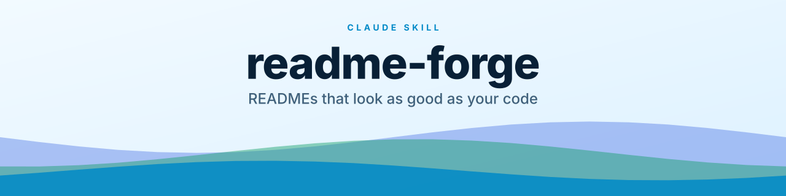</picture>

<b><code>--style wave</code></b><br><sub>layered animated waves</sub>

</td>
<td width="33%" valign="top">

<picture><source media="(prefers-color-scheme: dark)" srcset="assets/banners/blueprint-dark.svg">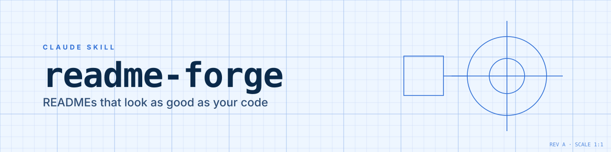</picture>

<b><code>--style blueprint</code></b><br><sub>engineering drawing that redraws</sub>

</td>
</tr>
<tr>
<td width="33%" valign="top">

<picture><source media="(prefers-color-scheme: dark)" srcset="assets/banners/constellation-dark.svg"></picture>

<b><code>--style constellation</code></b><br><sub>twinkling particle network</sub>

</td>
<td width="33%" valign="top">

<picture><source media="(prefers-color-scheme: dark)" srcset="assets/banners/minimal-dark.svg"></picture>

<b><code>--style minimal</code></b><br><sub>clean type, one sweeping accent</sub>

</td>
<td width="33%" valign="top">

<picture><source media="(prefers-color-scheme: dark)" srcset="assets/banners/bold-dark.svg">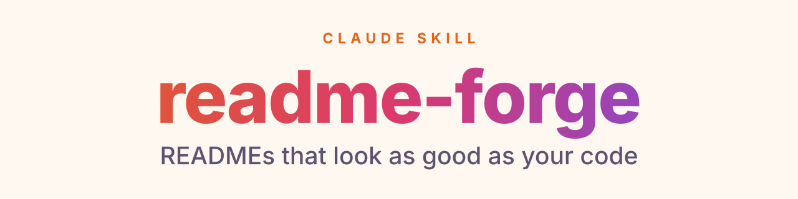</picture>

<b><code>--style bold</code></b><br><sub>oversized type, moving gradient</sub>

</td>
</tr>
<tr>
<td width="33%" valign="top">

<picture><source media="(prefers-color-scheme: dark)" srcset="assets/banners/pulse-dark.svg"></picture>

<b><code>--style pulse</code></b><br><sub>soft rings breathing behind the title</sub>

</td>
<td width="33%" valign="top"></td>
<td width="33%" valign="top"></td>
</tr>
</table>

Palettes: `ember` · `ocean` · `violet` · `mint` · `sunset` · `mono` · `cyber` · dark-design `midnight` · `carbon` · `ghost` · `obsidian` · ShaderGradient `halo` · `pensive` · `interstella` · `universe` · `mandarin` · `nighty` · shader `inferno` · `prism`, or any brand colour with `--accent "#HEX"`.

Footers (`--kind footer --style wave|minimal|vortex`), dividers (`--kind divider`, `--style beam` for a comet of light) and clickable CTA buttons (`--kind button --variant primary|secondary`) are in [the full gallery](assets/banners/gallery.md).

## Profile READMEs

[`templates/profile/`](templates/profile/) has 19 archetypes covering every category of the awesome-github-profile gallery: `minimal` · `creative` · `stats-dashboard` · `code-mode` · `badges-wall` · `retro` · `student` · `data-scientist` · `oss-maintainer` · `actions-dynamic` · `org-profile` · `game-mode` · `typing` · `anime-art` · `fancy-fonts` · `descriptive` · `simple-innovative` · `icons` · `just-image`.

[`templates/profile/workflows/`](templates/profile/workflows/) has 6 profile Actions: contribution snake, latest blog posts, WakaTime stats, metrics, a 3D contribution calendar, and a community tic-tac-toe game. Every widget URL in the templates was checked with readme-forge's `check_links.py`; hosts that now return HTTP 402 are left out or replaced by self-hosted Actions.

`scripts/fancy_text.py` converts text to Unicode bold, italic, mono and double-struck styles for profile headings.

## What's inside

```text
readme-forge-design/
├── SKILL.md            # design and profile modes
├── references/         # design.md (patterns, style picker, SVG facts), profile-readme.md, widgets.md
├── templates/
│   ├── design/         # centered header, profile header, landing-page hero, CTA section, footers
│   └── profile/        # 19 archetypes, workflows/, game/
├── assets/banners/     # every style, dark + light, and gallery.md
└── scripts/            # make_banner.py, fancy_text.py
```

## Limitations

- `orbit`, `terminal`, `bold`, `ribbon` and the spotlight pill animate with SMIL, which keeps playing when reduced motion is on ([#32](https://github.com/tanmayai23/README-Editor-skill/issues/32)). All other styles use CSS only.
- PyPI, npm and Hugging Face ignore `<picture>`. Ask readme-forge for a platform port, which switches to single images with absolute URLs.
- Widget hosts change. Run `check_links.py` from the core skill before publishing a profile.

## Contributing

New styles are welcome. Include dark and light renders, keep the first frame complete, use CSS animation instead of SMIL, and run `python scripts/make_banner.py --gallery assets/banners` so the gallery stays current. See [CONTRIBUTING.md](../CONTRIBUTING.md).

## License

MIT. See [LICENSE](../LICENSE).
