<!-- Generated by readme-forge-design make_page.py. Edit the spec and re-run instead of editing the SVGs. -->

<a href="https://example.com/"><picture><source media="(prefers-color-scheme: dark)" srcset="./assets/kai/hero-dark.svg"></picture></a>

<a href="https://github.com/octocat"><picture><source media="(prefers-color-scheme: dark)" srcset="./assets/kai/dock-github-dark.svg"></picture></a>
<a href="https://example.com/linkedin"><picture><source media="(prefers-color-scheme: dark)" srcset="./assets/kai/dock-linkedin-dark.svg"></picture></a>
<a href="mailto:kai@example.com"><picture><source media="(prefers-color-scheme: dark)" srcset="./assets/kai/dock-email-dark.svg"></picture></a>
<a href="https://example.com/leetcode"><picture><source media="(prefers-color-scheme: dark)" srcset="./assets/kai/dock-leetcode-dark.svg"></picture></a>
<a href="https://example.com/codeforces"><picture><source media="(prefers-color-scheme: dark)" srcset="./assets/kai/dock-codeforces-dark.svg"></picture></a>

  

<picture><source media="(prefers-color-scheme: dark)" srcset="./assets/kai/section-01-dark.svg">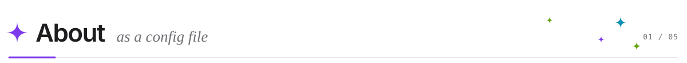</picture>
<picture><source media="(prefers-color-scheme: dark)" srcset="./assets/kai/portrait-dark.svg"></picture>

<picture><source media="(prefers-color-scheme: dark)" srcset="./assets/kai/code-dark.svg"></picture>

  

<picture><source media="(prefers-color-scheme: dark)" srcset="./assets/kai/section-02-dark.svg">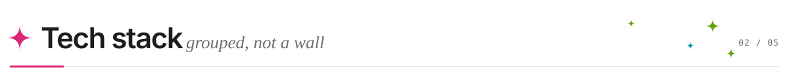</picture>
<picture><source media="(prefers-color-scheme: dark)" srcset="./assets/kai/stack-dark.svg">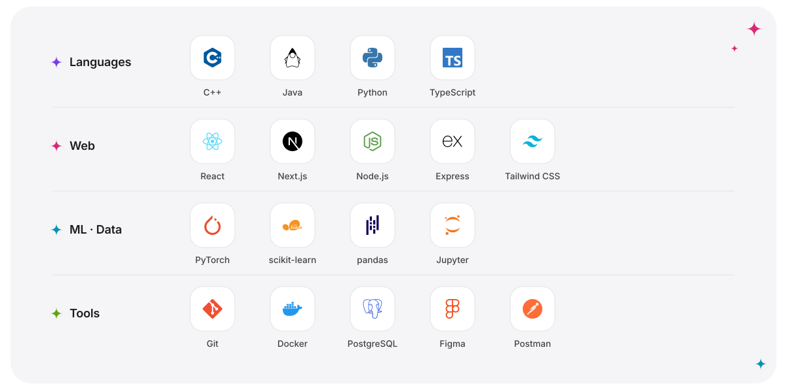</picture>

  

<picture><source media="(prefers-color-scheme: dark)" srcset="./assets/kai/section-03-dark.svg">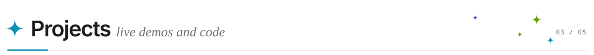</picture>

<table>
<tr><td width="50%" align="center" valign="top"><a href="https://example.com/gridlock"><picture><source media="(prefers-color-scheme: dark)" srcset="./assets/kai/project-gridlock-dark.svg"></picture></a> <a href="https://example.com/gridlock">Live ↗</a> · <a href="https://example.com/gridlock/code">Code ↗</a></td><td width="50%" align="center" valign="top"><a href="https://example.com/waveline"><picture><source media="(prefers-color-scheme: dark)" srcset="./assets/kai/project-waveline-dark.svg">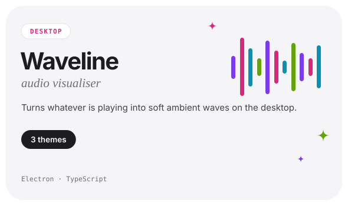</picture></a> <a href="https://example.com/waveline">Live ↗</a> · <a href="https://example.com/waveline/code">Code ↗</a></td></tr>
<tr><td width="50%" align="center" valign="top"><a href="https://example.com/timekeep"><picture><source media="(prefers-color-scheme: dark)" srcset="./assets/kai/project-timekeep-dark.svg">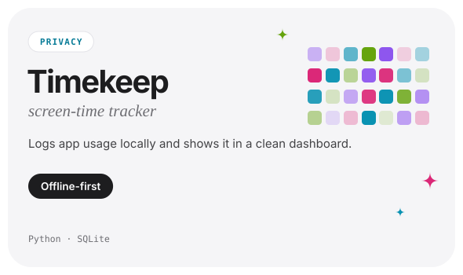</picture></a> <a href="https://example.com/timekeep">Download ↗</a> · <a href="https://example.com/timekeep/code">Code ↗</a></td><td width="50%" align="center" valign="top"><a href="https://example.com/solutions"><picture><source media="(prefers-color-scheme: dark)" srcset="./assets/kai/project-solutions-dark.svg"></picture></a> <a href="https://example.com/solutions">Code ↗</a></td></tr>
</table>

  

<picture><source media="(prefers-color-scheme: dark)" srcset="./assets/kai/section-04-dark.svg">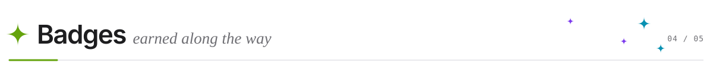</picture>
<picture><source media="(prefers-color-scheme: dark)" srcset="./assets/kai/certs-dark.svg">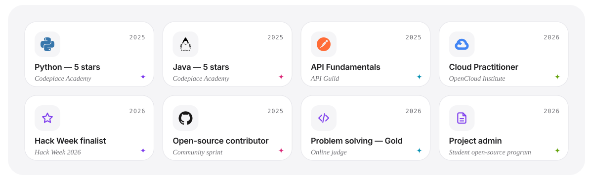</picture>

  

<picture><source media="(prefers-color-scheme: dark)" srcset="./assets/kai/section-05-dark.svg">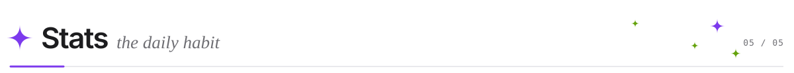</picture>

<!-- Shared public instances can be rate-limited. For reliability, self-host them or commit the SVGs from an Action (workflows/metrics.yml). -->
<picture><source media="(prefers-color-scheme: dark)" srcset="https://github-readme-stats.vercel.app/api?username=octocat&amp;show_icons=true&amp;bg_color=161B22&amp;title_color=F5F5F7&amp;text_color=D0D7DE&amp;icon_color=A78BFA&amp;ring_color=A78BFA&amp;hide_border=true&amp;border_radius=24&amp;custom_title=GitHub%20stats"></picture>
<picture><source media="(prefers-color-scheme: dark)" srcset="https://streak-stats.demolab.com?user=octocat&amp;background=161B22&amp;border=30363D&amp;stroke=30363D&amp;ring=A78BFA&amp;fire=F472B6&amp;currStreakNum=F5F5F7&amp;sideNums=F5F5F7&amp;currStreakLabel=A78BFA&amp;sideLabels=8B949E&amp;dates=8B949E&amp;hide_border=true&amp;border_radius=24"></picture>
<picture><source media="(prefers-color-scheme: dark)" srcset="https://github-readme-stats.vercel.app/api/top-langs/?username=octocat&amp;layout=compact&amp;langs_count=8&amp;bg_color=161B22&amp;title_color=F5F5F7&amp;text_color=D0D7DE&amp;hide_border=true&amp;border_radius=24"></picture>

  

<a href="mailto:kai@example.com"><picture><source media="(prefers-color-scheme: dark)" srcset="./assets/kai/footer-dark.svg"></picture></a>

