<!-- Generated by readme-forge-design make_page.py. Edit the spec and re-run instead of editing the SVGs. -->

<a href="https://example.com/"><picture><source media="(prefers-color-scheme: dark)" srcset="./assets/hello/hero-dark.svg"></picture></a>

<a href="https://example.com/linkedin"><picture><source media="(prefers-color-scheme: dark)" srcset="./assets/hello/dock-linkedin-dark.svg"></picture></a>
<a href="https://example.com/x"><picture><source media="(prefers-color-scheme: dark)" srcset="./assets/hello/dock-x-dark.svg"></picture></a>
<a href="mailto:hello@example.com"><picture><source media="(prefers-color-scheme: dark)" srcset="./assets/hello/dock-email-dark.svg"></picture></a>
<a href="https://example.com/"><picture><source media="(prefers-color-scheme: dark)" srcset="./assets/hello/dock-portfolio-dark.svg"></picture></a>
<a href="https://github.com/octocat"><picture><source media="(prefers-color-scheme: dark)" srcset="./assets/hello/dock-github-dark.svg"></picture></a>

  

<picture><source media="(prefers-color-scheme: dark)" srcset="./assets/hello/section-01-dark.svg">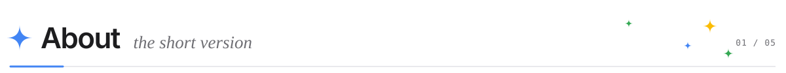</picture>
<picture><source media="(prefers-color-scheme: dark)" srcset="./assets/hello/about-dark.svg"></picture>

  

<picture><source media="(prefers-color-scheme: dark)" srcset="./assets/hello/section-02-dark.svg"></picture>
<picture><source media="(prefers-color-scheme: dark)" srcset="./assets/hello/stack-dark.svg">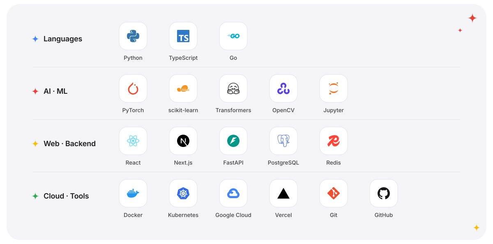</picture>

  

<picture><source media="(prefers-color-scheme: dark)" srcset="./assets/hello/section-03-dark.svg">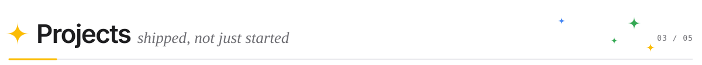</picture>
<a href="https://example.com/tidewatch"><picture><source media="(prefers-color-scheme: dark)" srcset="./assets/hello/project-tidewatch-dark.svg"></picture></a>
<a href="https://example.com/echo"><picture><source media="(prefers-color-scheme: dark)" srcset="./assets/hello/project-echo-dark.svg">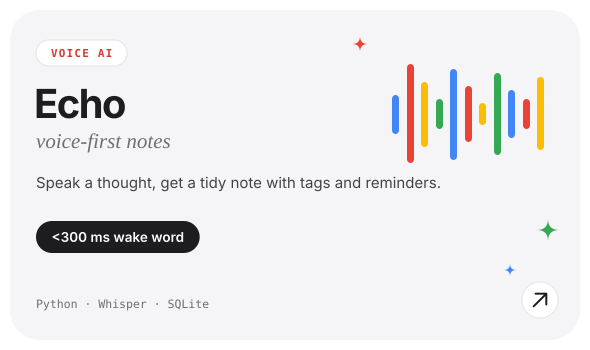</picture></a>
<a href="https://example.com/ledgerly"><picture><source media="(prefers-color-scheme: dark)" srcset="./assets/hello/project-ledgerly-dark.svg"></picture></a>
<a href="https://example.com/leafscan"><picture><source media="(prefers-color-scheme: dark)" srcset="./assets/hello/project-leafscan-dark.svg"></picture></a>
<a href="https://example.com/wander"><picture><source media="(prefers-color-scheme: dark)" srcset="./assets/hello/project-wander-dark.svg"></picture></a>

<a href="https://example.com/transcribe"><picture><source media="(prefers-color-scheme: dark)" srcset="./assets/hello/more-transcribe-dark.svg"></picture></a>
<a href="https://example.com/moodboard"><picture><source media="(prefers-color-scheme: dark)" srcset="./assets/hello/more-moodboard-dark.svg"></picture></a>
<a href="https://github.com/octocat?tab=repositories"><picture><source media="(prefers-color-scheme: dark)" srcset="./assets/hello/more-all-repositories-dark.svg"></picture></a>

  

<picture><source media="(prefers-color-scheme: dark)" srcset="./assets/hello/section-04-dark.svg">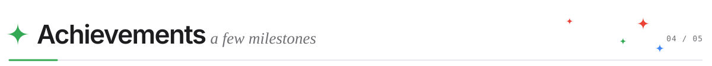</picture>
<picture><source media="(prefers-color-scheme: dark)" srcset="./assets/hello/achievement-01-dark.svg"></picture>
<picture><source media="(prefers-color-scheme: dark)" srcset="./assets/hello/achievement-02-dark.svg"></picture>
<picture><source media="(prefers-color-scheme: dark)" srcset="./assets/hello/achievement-03-dark.svg">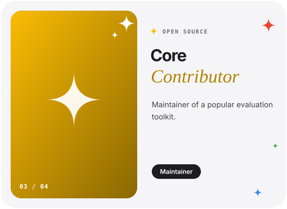</picture>
<picture><source media="(prefers-color-scheme: dark)" srcset="./assets/hello/achievement-04-dark.svg">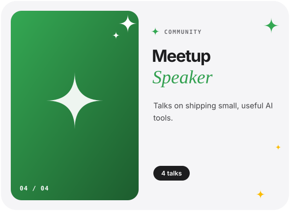</picture>

  

<picture><source media="(prefers-color-scheme: dark)" srcset="./assets/hello/section-05-dark.svg">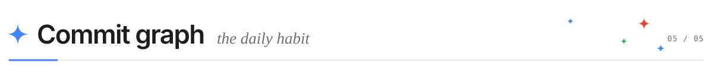</picture>

<!-- Shared public instances can be rate-limited. For reliability, self-host them or commit the SVGs from an Action (workflows/metrics.yml). -->
<picture><source media="(prefers-color-scheme: dark)" srcset="https://github-readme-stats.vercel.app/api?username=octocat&amp;show_icons=true&amp;include_all_commits=true&amp;bg_color=161B22&amp;title_color=F5F5F7&amp;text_color=D0D7DE&amp;icon_color=8AB4F8&amp;ring_color=8AB4F8&amp;hide_border=true&amp;border_radius=24&amp;custom_title=GitHub%20stats"></picture>
<picture><source media="(prefers-color-scheme: dark)" srcset="https://streak-stats.demolab.com?user=octocat&amp;background=161B22&amp;border=30363D&amp;stroke=30363D&amp;ring=8AB4F8&amp;fire=F28B82&amp;currStreakNum=F5F5F7&amp;sideNums=F5F5F7&amp;currStreakLabel=8AB4F8&amp;sideLabels=8B949E&amp;dates=8B949E&amp;hide_border=true&amp;border_radius=24"></picture>

  

<a href="mailto:hello@example.com"><picture><source media="(prefers-color-scheme: dark)" srcset="./assets/hello/footer-dark.svg"></picture></a>

