<!-- Generated by readme-forge-design make_page.py. Edit the spec and re-run instead of editing the SVGs. -->

<div align="center">

<a href="https://github.com/tanmayai23/README-Editor-skill"><picture><source media="(prefers-color-scheme: dark)" srcset="./assets/page/hero-dark.svg"></picture></a>

</div>

<p align="center"><b>A Claude skill that writes READMEs from your code, then checks every command, env var and path in them against the repo.</b></p>

<div align="center">

<br><br>

<picture><source media="(prefers-color-scheme: dark)" srcset="./assets/page/section-01-dark.svg"></picture>
<a href="https://github.com/tanmayai23/README-Editor-skill"><picture><source media="(prefers-color-scheme: dark)" srcset="./assets/page/project-verify-readme-py-dark.svg"></picture></a>
<picture><source media="(prefers-color-scheme: dark)" srcset="./assets/page/project-readme-forge-dark.svg"></picture>
<picture><source media="(prefers-color-scheme: dark)" srcset="./assets/page/project-github-action-dark.svg"></picture>

<br><br>

<picture><source media="(prefers-color-scheme: dark)" srcset="./assets/page/section-02-dark.svg"></picture>

</div>

```bash
claude plugin install readme-forge --marketplace tanmayai23/README-Editor-skill
```

Then, in Claude Code: `/readme-forge write a README for this repo`.

<div align="center">

<br><br>

<picture><source media="(prefers-color-scheme: dark)" srcset="./assets/page/section-03-dark.svg"></picture>
<picture><source media="(prefers-color-scheme: dark)" srcset="./assets/page/stack-dark.svg"></picture>

<br><br>

<a href="https://github.com/tanmayai23/README-Editor-skill"><picture><source media="(prefers-color-scheme: dark)" srcset="./assets/page/footer-dark.svg"></picture></a>

</div>
