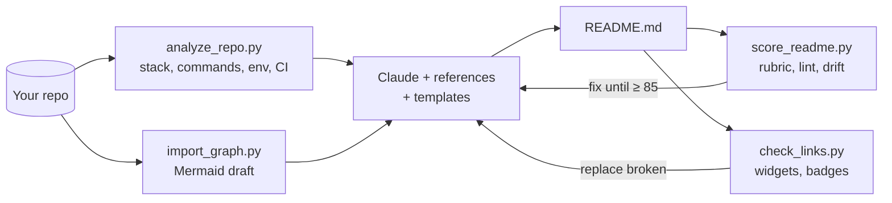

# readme-forge

**A Claude skill that writes, audits, and fixes READMEs using facts from your actual code: project READMEs, GitHub profile READMEs, and Hugging Face model/dataset/Space cards.**


```text
> /readme-forge write a README for this repo
  ✓ analyzed: TypeScript monorepo · bun · FastAPI backend · 4 compose services · 7 env vars
  ✓ architecture diagram drafted from 312 real imports
  ✓ README.md written · score 91/100 (A) · 2 TODOs need your input (demo GIF, live URL)
```

**Contents:** [Why](#why) · [Quickstart](#quickstart) · [What you can ask](#what-you-can-ask) · [How it works](#how-it-works) · [Scripts](#scripts) · [What's inside](#whats-inside) · [Guarantees](#guarantees) · [Limitations](#limitations)

## Why

README generators fill a fixed template, and template collections expect you to copy-paste and fill in everything by hand. Neither reads your code, so the result is generic, often wrong, and goes stale. readme-forge fills the gaps we found in the existing tools:

| Gap in existing tools | What readme-forge does |
|---|---|
| Only reads `package.json` (readme-md-generator, unmaintained since 2019) | Detects 15+ ecosystems, monorepos, package managers, scripts, env vars, Docker, CI, routes |
| No architecture visuals | Builds a **Mermaid diagram from real imports**, including DBs, queues and APIs it finds |
| GitHub-only output | Writes for **GitHub, Hugging Face, PyPI, npm, GitLab, VS Code Marketplace** with each platform's rendering rules |
| No quality feedback | **0–100 score + linter** (structure, accessibility, dead links, filler words, placeholders) |
| READMEs drift from the code | **Drift check**: wrong package manager, missing scripts/make targets, undocumented env vars |
| Profile generators embed dead widgets | Widget catalog with **tested endpoints**, dark/light `<picture>`, fallbacks; flags herokuapp and HTTP-402 hosts |
| No Hugging Face support | Model, dataset and Space cards with **validated YAML frontmatter** |
| Banners come from rate-limited third-party services, and nothing is designed | **16 animated SVG banner styles** (3D synthwave, isometric, orbit, glass, terminal, neon, wave, …), plus footers and dividers, generated locally in dark and light versions with a complete first frame |

## Quickstart

**Claude Code**: install it as a plugin (Claude Code 2.1.275 or later):

```text
/plugin install readme-forge --marketplace tanmayai23/README-Editor-skill
```

Or copy the folder into your skills directory:

```bash
git clone https://github.com/tanmayai23/README-Editor-skill.git readme-forge-src
cp -r readme-forge-src/readme-forge ~/.claude/skills/readme-forge
```

Then, in any project:

```text
/readme-forge write a README for this repo
```

**claude.ai / Claude Desktop**: zip the `readme-forge` folder and upload it under *Settings → Capabilities → Skills*.

## What you can ask

| You say | Mode |
|---|---|
| "Write a README for this repo" | Project README from code facts |
| "Make my GitHub profile README, creative style" | Profile README (19 archetypes) |
| "Create a model card for this fine-tune" | Hugging Face card |
| "Review / improve my README" | Audit: score, drift, ranked fixes, rewrite |
| "Make a PyPI version of the README" | Port to another platform |
| "Make this repo open-source ready" | README + CONTRIBUTING, SECURITY, CoC, templates |
| "Give my README a better header and footer" | Design pass: banner options in your colours, footer, palette, layout |

## How it works

The skill runs five stdlib-only Python scripts for facts and checks. Claude writes the prose from those facts plus the reference guides, then scores the result and fixes problems until it passes.



## Scripts

You can run each script on its own. They need no dependencies.

```bash
python scripts/analyze_repo.py path/to/repo              # JSON facts
python scripts/import_graph.py path/to/repo --mermaid    # architecture draft
python scripts/score_readme.py README.md --repo .        # score + lint + drift
python scripts/score_readme.py README.md --profile       # profile rubric
python scripts/score_readme.py README.md --hf            # Hugging Face card rubric
python scripts/check_links.py README.md                  # network: verify every URL
python scripts/make_banner.py --style orbit --title "my-app" --subtitle "What it does" --out .github/assets
python scripts/make_banner.py --list                     # 16 styles, 17 palettes
```

Example output:

```text
README score: 82/100  grade B  [project]  README.md
----------------------------------------------------------------
  identity         ████████░░    12/15
  getting-started  ██████████    25/25
  structure        ██████████    15/15
  visuals          ████░░░░░░     4/10
  community        ██████████    15/15
  quality          ███████░░░    14/20
----------------------------------------------------------------
  ERROR [quality] unfilled template placeholder (line 225)
  WARN  [accessibility] non-descriptive alt text 'Logo' for images/logo.png (line 34)
```

Gate pull requests on README quality: `python score_readme.py README.md --repo . --min 80` exits 1 below the threshold.

## What's inside

```text
readme-forge/
├── SKILL.md              # mode routing, hard rules, step-by-step workflows
├── references/           # loaded on demand
│   ├── project-readme.md # blueprints for 10 project types
│   ├── profile-readme.md # 19 profile archetypes + interview
│   ├── widgets.md        # stats/streak/snake/typing/skill-icons, with reliability tiers
│   ├── badges.md         # shields.io recipes per ecosystem
│   ├── diagrams.md       # Mermaid architecture, sequence, ER, charts
│   ├── platforms.md      # GitHub vs HF vs PyPI vs npm rendering matrix
│   ├── huggingface.md    # model/dataset/Space frontmatter schema
│   ├── design.md         # header/footer patterns, banner style picker, colour, typography, SVG facts
│   ├── quality-rubric.md # scoring + lint rules + manual review checklist
│   └── writing-style.md  # banned filler, tone, code-block rules
├── templates/
│   ├── project/          # library, cli, webapp, api, ml-project, monorepo, minimal
│   ├── profile/          # 19 archetypes + workflows/ (snake, metrics, blog posts, WakaTime, tic-tac-toe)
│   ├── huggingface/      # model-card, dataset-card, space-readme
│   ├── design/           # header-centered, header-profile, footer-quiet, footer-svg
│   └── extras/           # CONTRIBUTING, CODE_OF_CONDUCT, SECURITY, SUPPORT, CHANGELOG, CITATION.cff, FUNDING, issue/PR templates
├── assets/banners/       # gallery: every style, dark + light
└── scripts/              # analyze_repo, import_graph, score_readme, check_links, make_banner, fancy_text
```

## Guarantees

- **No invented facts.** Commands, env vars, versions and numbers come from your files or from you. Unknowns become `<!-- TODO -->` and are listed back to you.
- **Accessible by default.** Alt text on every image, no skipped heading levels, at most 2 animations, descriptive link text.
- **Platform-correct.** No Mermaid on PyPI, no `<picture>` on Hugging Face, absolute URLs where relative links break.

## Limitations

- Import graphs cover Python, JavaScript/TypeScript, Go and Rust. Other languages get a structure-based diagram that Claude writes by hand.
- Route detection is heuristic (FastAPI/Flask/Express/Spring/Gin-style decorators and calls).
- Widget hosts change. Run `check_links.py` before publishing a profile README.

## Contributing

Issues and pull requests are welcome. Add a test repo under `tests/` when you change detection logic, and run all four scripts against it before submitting.

## License

MIT
