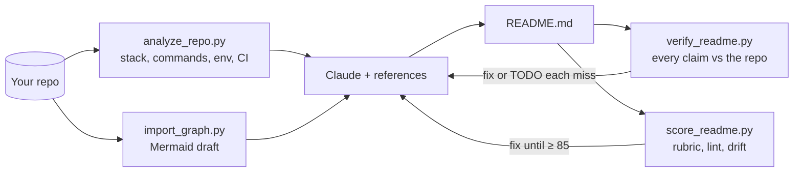

# readme-forge

**A Claude skill that writes, audits and fixes READMEs from facts in your code, then checks every command, env var and path in them against the repository.**


**Contents:** [Features](#features) · [Quickstart](#quickstart) · [Usage](#usage) · [How it works](#how-it-works) · [Scripts](#scripts) · [What's inside](#whats-inside) · [Limitations](#limitations)

## Features

- **Facts from 15 ecosystems.** `analyze_repo.py` reads manifests, lockfiles, scripts, make/just targets, env vars, Docker, CI and routes for Node, Python, Rust, Go, JVM, Ruby, PHP, Dart, Elixir, .NET, C/C++, Deno, Swift, Zig and Haskell. Each ecosystem has a fixture and a unit test.
- **Claim verification.** `verify_readme.py` pulls every command, script, flag, env var and path out of a README and checks each one against the repo. Anything it can't find is reported as a likely hallucination.
- **Architecture from real imports.** `import_graph.py` drafts a Mermaid diagram from Python, JS/TS, Go and Rust imports.
- **Score and drift.** `score_readme.py` grades a README 0–100 and flags drift: wrong package manager, missing scripts, undocumented env vars, dead relative links.
- **Platforms.** GitHub, Hugging Face model/dataset/Space cards with validated YAML, and PyPI/npm/GitLab ports.

Banners and GitHub profile READMEs are in the optional [readme-forge-design](../readme-forge-design/README.md) skill.

## Quickstart

```bash
claude plugin install readme-forge --marketplace tanmayai23/README-Editor-skill
```

Or copy the folder into your skills directory:

```bash
git clone https://github.com/tanmayai23/README-Editor-skill.git readme-forge-src
cp -r readme-forge-src/readme-forge ~/.claude/skills/readme-forge
```

**claude.ai / Claude Desktop:** download `readme-forge.zip` from the [latest release](https://github.com/tanmayai23/README-Editor-skill/releases/latest) and upload it under *Settings → Capabilities → Skills*.

## Usage

| You say | Mode |
|---|---|
| "Write a README for this repo" | Project README from code facts, verified claim by claim |
| "Is my README accurate?" / "Review my README" | Audit: claim check, score, drift, ranked fixes, rewrite |
| "Create a model card for this fine-tune" | Hugging Face card |
| "Make a PyPI version of the README" | Port to another platform |
| "Make this repo open-source ready" | README + CONTRIBUTING, SECURITY, CoC, templates |

## How it works



## Scripts

Each script runs on its own with no dependencies.

```bash
python scripts/analyze_repo.py path/to/repo                    # JSON facts
python scripts/import_graph.py path/to/repo --mermaid          # architecture draft
python scripts/verify_readme.py README.md --repo path/to/repo  # check every claim
python scripts/score_readme.py README.md --repo path/to/repo   # score + lint + drift
python scripts/score_readme.py README.md --hf                  # Hugging Face card rubric
python scripts/check_links.py README.md                        # network: verify every URL
```

`verify_readme.py --min-accuracy 100` and `score_readme.py --min 85` exit 1 below the threshold, so either can gate CI. The [GitHub Action](../action/README.md) runs both on pull requests and comments the result.

## What's inside

```text
readme-forge/
├── SKILL.md              # mode routing, hard rules, step-by-step workflows
├── references/           # project blueprints, badges, diagrams, platforms, Hugging Face, rubric, writing style
├── templates/
│   ├── project/          # library, cli, webapp, api, ml-project, monorepo, minimal
│   ├── huggingface/      # model card, dataset card, Space README
│   └── extras/           # CONTRIBUTING, CODE_OF_CONDUCT, SECURITY, SUPPORT, CHANGELOG, CITATION.cff, FUNDING, issue/PR templates
└── scripts/              # analyze_repo, import_graph, verify_readme, score_readme, check_links
```

## Limitations

- `verify_readme.py` checks claims offline. It can't tell whether `pip install NAME` resolves on PyPI or whether a command succeeds at runtime; those claims are reported as unverifiable, not as correct.
- Import graphs cover Python, JavaScript/TypeScript, Go and Rust. Other languages get a structure-based diagram that Claude writes by hand.
- Route detection is heuristic (FastAPI/Flask/Express/Spring/Gin-style decorators and calls).

## Contributing

Add a fixture under `tests/fixtures/` and a unit test when you change detection or verification logic. See [CONTRIBUTING.md](../CONTRIBUTING.md).

## License

MIT. See [LICENSE](../LICENSE).
