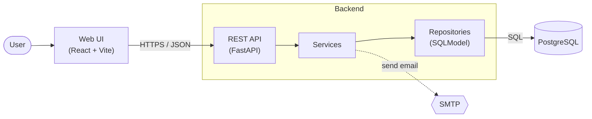
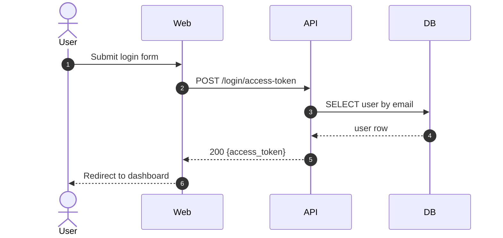
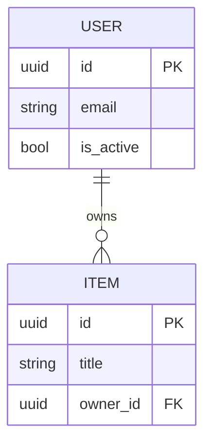
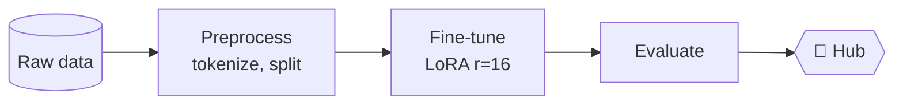
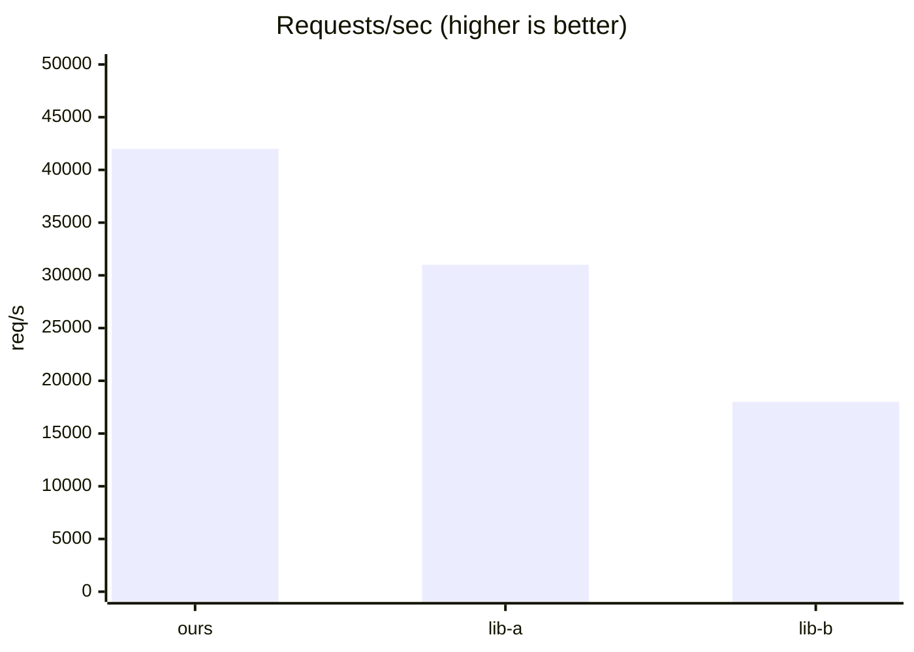
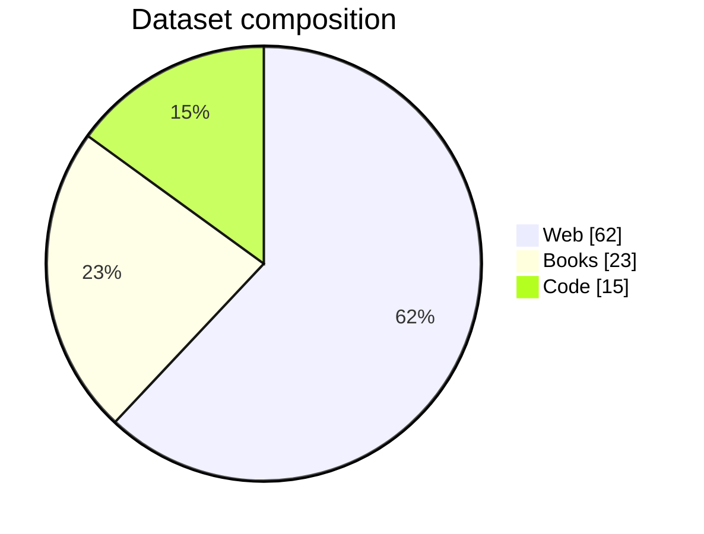

# Diagrams & charts from real code

Mermaid renders natively on **GitHub, GitLab, Gitea/Forgejo, Azure DevOps, Obsidian and VS Code preview**. It does **not** render on PyPI or npm, and you can't count on it on Hugging Face. On those platforms, use a pre-rendered SVG/PNG (`npx -p @mermaid-js/mermaid-cli mmdc -i arch.mmd -o docs/arch.svg`) and reference it by absolute URL.

## Workflow
1. `python scripts/import_graph.py <repo> --mermaid` gives a draft built from real imports. External systems (DB, cache, queue, LLM/HTTP APIs, cloud) are inferred from the imported libraries.
2. Read the entrypoints and 2–3 central modules (the nodes with the most edges) to learn what each group *does*.
3. Rewrite the draft for humans:
   - Rename nodes from folder names to roles: `api` → "REST API (FastAPI)", `core` → "Domain logic".
   - Keep **≤ 15 nodes**. Merge utilities, drop config/test/types nodes.
   - Label edges with verbs: `-->|"HTTP/JSON"|`, `-->|"SQL"|`, `-.->|"enqueue"|`.
   - Group with `subgraph` by deployable unit (Browser, Backend, Worker, Infra).
   - Add actors at the edges, such as the User or an external webhook.
4. Use `flowchart LR` for pipelines and request paths, and `flowchart TB` for layered architectures.
5. Check the syntax: a node id must not be `end`. Quote any label that contains `()[]{}:;`. Keep `<br/>` line breaks rare.

## Which diagram for which question

| Question the reader has | Diagram | Source of truth |
|---|---|---|
| What are the parts and how do they connect? | `flowchart` (architecture) | import_graph, compose services, packages_detail |
| What happens when I call X / click Y? | `sequenceDiagram` | route handler → service → DB calls |
| What's in the database? | `erDiagram` | ORM models / Prisma schema / migrations |
| What states can an entity be in? | `stateDiagram-v2` | enums and status fields |
| What are the main classes? (libraries) | `classDiagram` (≤ 8 classes) | public exports |
| How does data flow through training? | `flowchart LR` | train.py / pipeline config |
| How is it deployed? | `flowchart` (or `architecture-beta`) | Dockerfile, compose, k8s, terraform |
| How does the git/release process work? | `gitGraph` | rarely needed |
| Timeline / roadmap | `timeline` or `gantt` | only real milestones |

## Templates

**Web app**


**Request sequence**


**ER (from ORM models)**


**ML pipeline**


## Charts (only with real numbers)

**Benchmarks:** a table is usually clearest. Bold the best value in each column, and state the hardware, dataset and version.

**Mermaid xychart** (GitHub supports it):

**Pie** (composition, ≤ 6 slices):

**Star history:** `[](https://star-history.com/#OWNER/REPO&Date)` (a `<picture>` with `&theme=dark` for dark mode).
**HF eval results:** put them in `model-index` frontmatter so the Hub renders them, and mirror them as a Markdown table in the card body.

## Accessibility for diagrams
- Put a one-sentence text summary above each diagram ("Requests go from the React UI to FastAPI, which reads and writes PostgreSQL and sends email through SMTP.").
- Mermaid supports `accTitle:` and `accDescr:` lines. Add them to important diagrams. **Never put `;` in them**, because Mermaid treats it as the end of the statement and the whole diagram fails with "Syntax error" (the linter checks for this):
  ```
  flowchart LR
      accTitle: System architecture
      accDescr: React UI calls the FastAPI backend, which uses PostgreSQL and SMTP.
  ```
- Pre-rendered images need alt text that describes the content, not "architecture diagram".
- Don't rely on color alone. Use labels and line styles (solid = sync, dotted = async).
